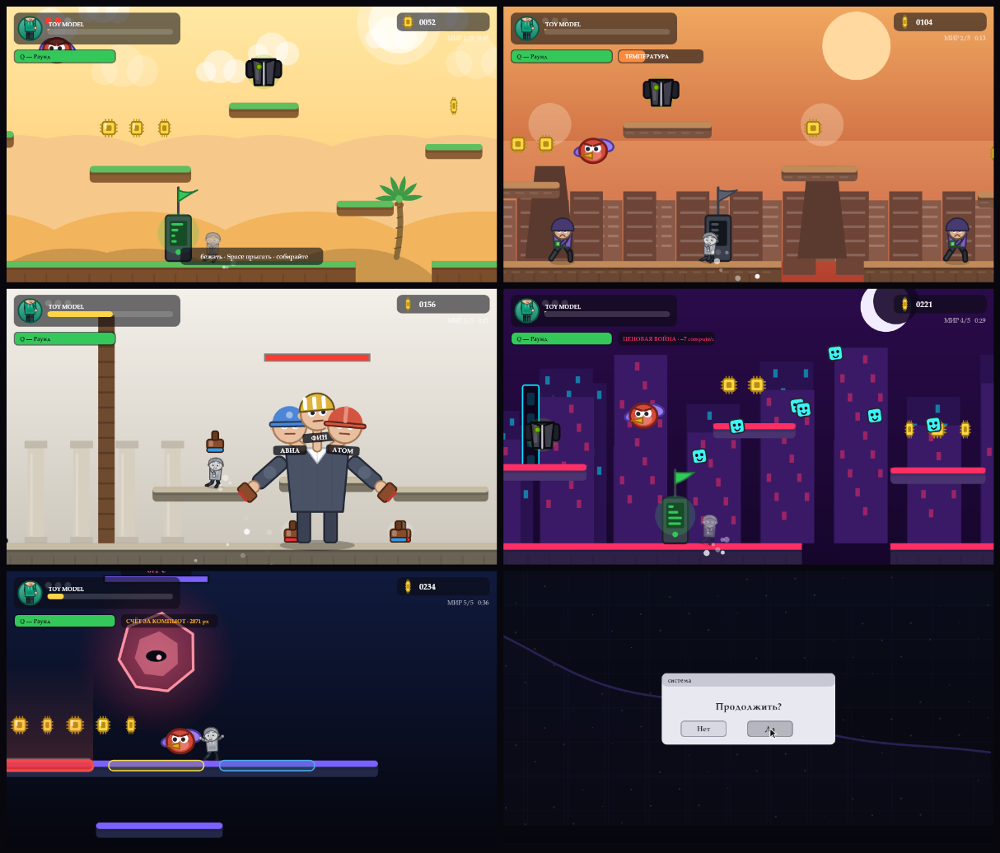
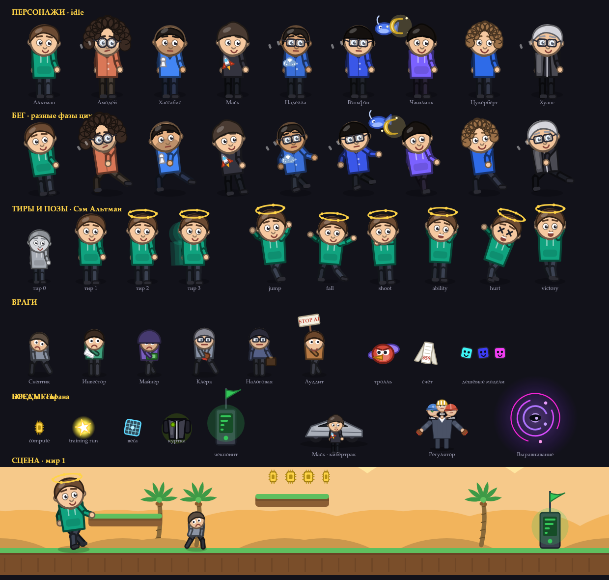

# AGI RUN

Браузерный платформер про гонку за созданием ИИ. Выбираешь одного из девяти
героев индустрии, пробиваешься через конкурентов, регуляторов, налоговую и
луддитов — и доходишь до AGI. Прохождение ≈ 10–14 минут.

**▶ Играть: https://agi-fighting.github.io/agi-run/**

**Пародия, сделанная с любовью.** Все персонажи — шарж на публичные образы.
Никакой связи с реальными компаниями, никаких логотипов, никаких выдуманных цитат.



---

## Запуск

Откройте `index.html` в браузере. Сборки нет, зависимостей нет, npm не нужен —
`art.js` просто должен лежать рядом.

| Клавиша | Действие |
|---|---|
| ← → / A D | Бег |
| Space / ↑ / W | Прыжок (переменной высоты) |
| X | Выстрел токеном (с тира 2) |
| Q | Способность персонажа |
| Shift | Рывок (у героев с этой пассивкой) |
| Esc | Пауза · R — заново |

На мобильных — экранные кнопки.

---

## Как устроена игра

**COMPUTE — единая валюта.** Чипы ⚡ это и монетки Марио, и шкала прогресса.
Каждые 100 поднимают тир модели: `Toy Model → Chatbot → Reasoner → Agent`.
Урон не убивает, а откатывает на тир назад — ошибка стоит прогресса, а не жизни.

**Девять героев меняют механику, а не скин.** Дарио блокирует первый удар, но
медленнее копит compute. У Маска рывок. У Яна Чжилиня огромный «контекст» —
камера показывает дальше, но на жизнь меньше. Дженсен Хуанг открывается за
пять спрятанных курток и получает собственную концовку.

### Пять миров

| Мир | Механика | Босс |
|---|---|---|
| 1 · Долина стартапов | обучение | **Ян Лекун** — кидает «мировые модели» |
| 2 · Пустыня дата-центров | перегрев: остывать в тени градирен | **Илон Маск** на кибертраке, две фазы |
| 3 · Столица регуляций | бумажные платформы тают, красная лента замораживает | **Трёхглавый Регулятор** — головоломка со штампами |
| 4 · Великая открытая стена | ценовая война: compute утекает постоянно | **Лян Вэньфэн + Ян Чжилинь** — их не победить силой |
| 5 · Лаборатория сингулярности | вертикальный подъём, снизу растёт счёт за компьют | **Проблема Выравнивания** — стрельба делает её сильнее |

Два боя намеренно ломают привычку игрока. Дуэт из мира 4 неуязвим — выиграть
можно, только поймав три пакета открытых весов и приняв их. Финальный босс
зеркалит игрока и лечится от каждого выстрела: побеждается совпадением, а не
атакой.

Ещё внутри: магазин Дженсена Хуанга, Ван Сяочуань лечит бесплатно (он ушёл из
гонки в ИИ-медицину), пять спрятанных кожаных курток, чекпоинты, сохранение
лучшего времени, концовка с золотой перемоткой и окном «Продолжить? [Да] [Нет]»,
карточка результата с кнопкой скачивания.

---

## Весь арт нарисован кодом

Обычно платформер — это папка со спрайт-листами. Здесь вместо неё `art.js`:
каждый персонаж описан набором параметров, а анимация считается синусами.

```js
altman:{ color:'#10A37F', hair:'#6B4A32', hairStyle:'sideSwept',
         outfit:'hoodie', glasses:null, mouth:'smirk', fw:1.00, hv:1.00 }
```

Ни одного PNG в игре: графика весит 0 КБ, любая правка — одна строка,
на Retina всё резкое, новый персонаж — десять строк.

```js
ART.drawChar(ctx,'altman',{x,y,state:'run',t,tier:2,dir:1,scale:1});
ART.drawFoe(ctx,'clerk',{x,y,t,dir,scale});
ART.drawVehicleBoss(ctx,'musk',{x,y,t,scale,dir});
ART.drawRegulator(ctx,{x,y,t,scale,fed:[true,false,false]});
ART.drawAlignment(ctx,{x,y,t,scale,phase:0|1|2,mirror:'altman'});
ART.drawSky / drawParallax / drawTile / drawChip / drawPaperPlat / drawTape /
ART.drawStamp / drawBillTide / drawPad / drawBubble / drawCheckpoint
```

Позы: `idle · run · jump · fall · land · shoot · ability · hurt · victory`.
Витрина всех спрайтов, поз, тиров и палитры — `artstyle.html`.

Звук — тоже без файлов: десяток осцилляторов на WebAudio.



---

## Проверено автотестами

- **Геометрия:** для всех 5 миров проверено, что каждая платформа достижима,
  каждый чип собираем, куртка доступна, арена босса открыта, а провалы
  перепрыгиваются. Высота прыжка 143 px — все перепады держатся ≤ 115 px.
- **Полное прохождение:** от меню через 5 миров и 5 боссов до концовки и
  карточки результата.
- **Фаззинг:** тысячи кадров случайного ввода на семи персонажах.
- **Прыжок на голову** каждому боссу проверяется отдельным тестом: боссы не
  должны быть выше прыжка.

---

## Что можно доделать

- Музыка (сейчас только звуковые эффекты)
- Мобильное управление работает, но не вылизано
- Больше секретов и реплик персонажей
- Таблица лидеров

---

## Правила, которые нельзя нарушать

1. Только добрый шарж — никаких издёвок над внешностью.
2. Никто не выглядит злодеем, даже боссы: в финале все аплодируют.
3. Никаких логотипов компаний — только цветовые ассоциации.
4. Никаких реальных политиков; Регулятор — вымышленный персонаж.
5. Никаких выдуманных цитат от лица реальных людей.

---

## Файлы

| Файл | Что это |
|---|---|
| `index.html` | Игра целиком |
| `art.js` | Арт-движок |
| `artstyle.html` | Витрина арта |
| `concept.md` | Гейм-дизайн-документ |

MIT.
